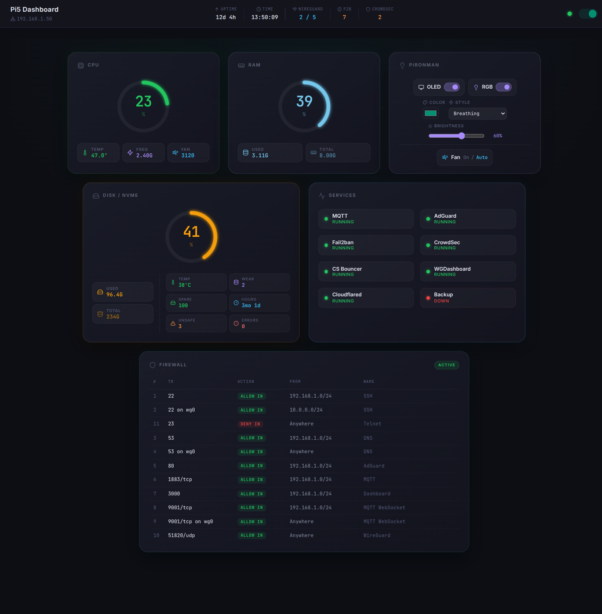
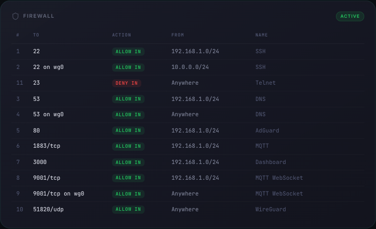
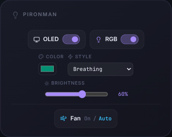

# Pi Dash

A live dashboard for a Raspberry Pi 5 in a Pironman5 case — metrics, history, services, containers, firewall and case controls — in a single Node.js service.

It merges [Pi5_MQTT](https://github.com/Alex93IDE/Pi5_MQTT) and [Pi5_Dashboard](https://github.com/Alex93IDE/Pi5_Dashboard) into one: no broker, no Python daemon, nothing to keep in sync.



## Features

- **Live metrics** — CPU (per core, load, temperature, fan), RAM, disk and NVMe health, network throughput, WireGuard peers. Pushed every second over Server-Sent Events.
- **History** — one averaged sample per minute in SQLite, charted over 1 hour, 24 hours, 7 days or 30 days.
- **Services and Docker** — every systemd unit and container, searchable, with favorites. Start, stop and restart them from the browser.
- **Apps** — your own links to whatever else runs on the Pi (Keeper, WGDashboard…).
- **Alerts** — failed units, stopped containers, firewall down, hot or full hardware, with the count in the browser tab.
- **UFW** rules, **Fail2ban** and **CrowdSec** ban counts.
- **Pironman5 controls** — OLED, RGB and fan mode.
- **Works on a phone** — responsive, swipe between tabs, installable as a PWA.

| Firewall | Pironman |
|---|---|
|  |  |

## How it works

```
Browser (Vue 3)  ◄── SSE: live data ──  Node.js server on the Pi (Express 5)
                 ── HTTP: commands ──►   reads /proc, systemctl, docker, smartctl,
                                         ufw, wg, the Pironman API; keeps SQLite
```

One process collects everything on a schedule, keeps the history and favorites in `data/pi-dash.db`, and serves both the API and the built dashboard.

```
server/   Express API, collectors, SQLite      (TypeScript, run directly by Node)
web/      the dashboard                        (Vue 3, Pinia, Vite, PWA)
shared/   types used by both sides
deploy/   install, update, uninstall and release scripts
```

## Requirements

- Raspberry Pi with a systemd-based distro (Raspberry Pi OS Bookworm or later)
- **Node.js 22.18+** (24 LTS recommended) — the server runs its TypeScript directly, and uses the built-in `node:sqlite`
- Optional: Pironman5 software, Docker, WireGuard, Fail2ban, CrowdSec, smartmontools. Anything missing just reports empty or zero values.

## Installation

On the Pi:

```bash
git clone https://github.com/Alex93IDE/Pi_Dash.git ~/pi-dash
cd ~/pi-dash
cp .env.example .env   # review it
bash deploy/install.sh
```

`install.sh` installs dependencies, builds the dashboard and sets up:

- a systemd service, `pi-dash`
- a sudoers rule for a few **read-only** commands (`ufw status`, `wg show`, `smartctl -A`, `fail2ban-client status`), only for the metrics enabled in `.env`
- with `UNIT_CONTROL=true`, a polkit rule letting the service user **start, stop and restart** systemd units — nothing else (no enable, mask or reboot)

Docker containers are listed and controlled through the `docker` group; the script tells you if your user isn't in it.

Then open `http://<pi-address>:3010`.

Update with `bash deploy/update.sh`. Remove with `bash deploy/uninstall.sh` (your `data/` is kept).

Logs: `journalctl -u pi-dash -f`

## Configuration

Everything lives in `.env` — see [`.env.example`](.env.example): port, intervals, history retention, which metrics to collect, and whether units can be controlled.

### Apps

The **Apps** tab holds links to other things on the Pi. Use `{host}` in the URL, e.g. `http://{host}:10086`: it becomes whatever address you opened the dashboard on, so the same link works on the LAN, over the VPN or by hostname.

## Development

Works on macOS or Linux; off the Pi, Linux-only metrics just read as zero.

```bash
npm install
npm run dev        # server on :3010 + Vite on :5173 with hot reload
npm test           # server tests
npm run typecheck
npm run build      # web/dist, served by the server in production
```

Releases follow [SemVer](https://semver.org): `bash deploy/release.sh patch|minor|major` on a clean `main`. The version lives in the root `package.json` and shows in the footer.

## Security

**There is no login, by design.** Anyone who can open the page can see your machine (IPs, ports, services, containers) and, with `UNIT_CONTROL=true`, stop and start services. So:

- Keep it on your LAN or behind a VPN. Never expose the port to the internet.
- Set `HOST` to the LAN or VPN address to keep it off other interfaces.
- Set `UNIT_CONTROL=false` if you only want to look.
- `PROTECTED_UNITS` can be restarted but never stopped — by default `ssh` and the dashboard itself, so you can't lock yourself out.

Cross-origin requests that change something are refused, so another web page open in your browser can't act on the Pi behind your back.

Nothing secret is stored in the repo or the built bundle: `.env` and `data/` are git-ignored.

## License

MIT — see [LICENSE](LICENSE).
